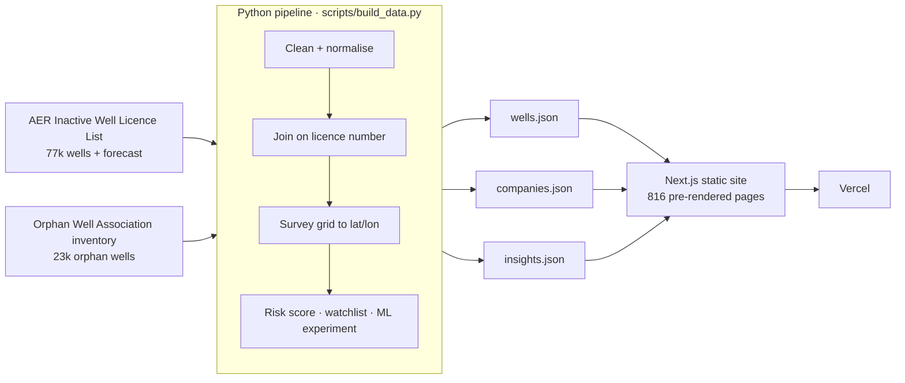

# Ghostwell

**Every inactive and orphaned oil & gas well in Alberta, mapped, scored and explained.**

Alberta has tens of thousands of oil and gas wells that stopped producing but were never cleaned up. When the company behind them goes bankrupt, they become **orphans**, and cleanup falls to the industry-funded Orphan Well Association. Farmers live with these wells on their land, and the cleanup bill runs into the billions.

Ghostwell turns two messy regulator spreadsheets into a tool that answers three questions:

| Who | Question | Feature |
|---|---|---|
| Anyone | Where are the riskiest abandoned wells? | **Risk map** of 91k wells with a 0–100 score you can click to explain |
| Regulators, analysts, investors | Which operators show the warning signs before wells get orphaned? | **Compliance watchlist** + a profile page for each of 810 companies |
| Landowners | Is there an inactive well near my land, and what can I do? | **Landowner lookup** by legal land description, with next steps |

Plus an **insights** page (trends, cleanup pipeline, regional breakdown, wells about to go inactive) and a **methodology** page with the architecture, scoring and a machine-learning experiment.

### Key findings (Oct 2026 data)
- **88,034** inactive or orphaned wells; **18,608** orphaned
- **41,199** idle for 10+ years; the median well has sat idle **10.7 years**
- **19,440** wells are overdue for inspection; **16,106** break AER Directive 013
- **2025** was the worst year on record for wells going inactive (5,531)
- **3,000+** producing wells are forecast to go inactive in the next few months
- An orphan-prediction model looks 95% accurate with a random split but drops to **0.70 AUC** when whole companies are held out: orphaning is driven by company failure, not well traits

## Architecture



## Tech stack
- **Data:** Python, pandas, NumPy, scikit-learn (HistGradientBoosting, GroupKFold, permutation importance)
- **Site:** Next.js (App Router, static export), React, TypeScript, Tailwind CSS
- **Maps & charts:** Leaflet (canvas renderer for 91k points), Recharts
- **Hosting:** Vercel

## How it works

**Cleaning and joining.** The AER file has metadata rows above the header, licence numbers with leading zeros and several date columns; the OWA file has six title rows, mixes wells with pipelines and facilities, and spells company names differently ("LONG RUN EXPLORATION LTD" vs "Long Run Exploration Ltd."). The pipeline normalises both, joins them on licence number to flag orphans, adds orphan wells missing from the AER list and drops sites already reclaimed.

**Locations.** Wells are recorded in the Dominion Land Survey (`7-21-57-21W4` = LSD 7, section 21, township 57, range 21, west of the 4th meridian), not GPS. Ghostwell converts each to latitude/longitude using the township grid and its snake-numbered sections, accurate to a few hundred metres. The landowner lookup does the same in TypeScript so people can type their own land description.

**Risk score (0–100).**

| Factor | Points |
|---|---|
| Years since last production (capped at 30) | up to 30 |
| AER deemed risk class High / Medium / Low | 25 / 12 / 0 |
| Orphaned | 15 |
| Sour gas (H2S) well | 10 |
| Non-compliant with Directive 013 | 10 |
| Within 30 km of a community | up to 10 |

**Compliance watchlist.** For operating companies with 25+ inactive wells: percentile rank on non-compliance rate (35%), overdue inspection rate (25%), share idle 10+ years (25%) and median years idle (15%). It ranks warning signs in public data; it is not a prediction that any company will fail.

**ML experiment.** A gradient-boosted classifier predicting orphan status from well traits. A random split scores AUC 0.95, but permutation importance shows it leans on latitude/longitude: it memorises where bankrupt companies operated. With GroupKFold (whole companies held out) it scores 0.70. Compliance and inspection fields were excluded because a defunct company stops reporting, so they're consequences, not causes. Conclusion: track company-level signals, which is what the watchlist does.

## Run it

```bash
pip install -r requirements.txt
python scripts/build_data.py      # needs the two .xlsx files in data/

cd site
npm install
npm run dev                       # http://localhost:3000
```

## Data sources
- [AER Inactive Well Licence List](https://www1.aer.ca/productcatalogue/_ALL.html)
- [Orphan Well Association site-specific inventory](https://www.orphanwell.ca/site-specific-inventory)

## Limitations
- Locations are approximate (the conversion ignores survey correction lines).
- The AER list covers inactive wells only, so company rates exclude producing wells.
- OWA-only wells lack AER attributes and get neutral defaults.
- Next: distance to rivers and lakes, cleanup cost estimates, PostgreSQL/PostGIS API.
